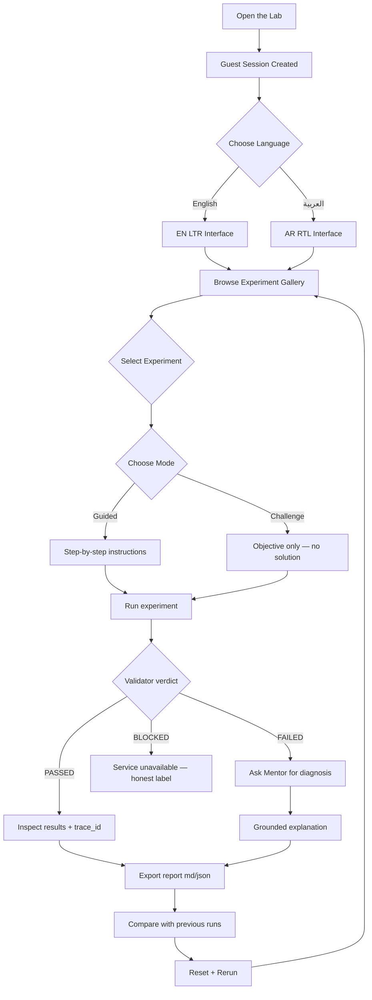
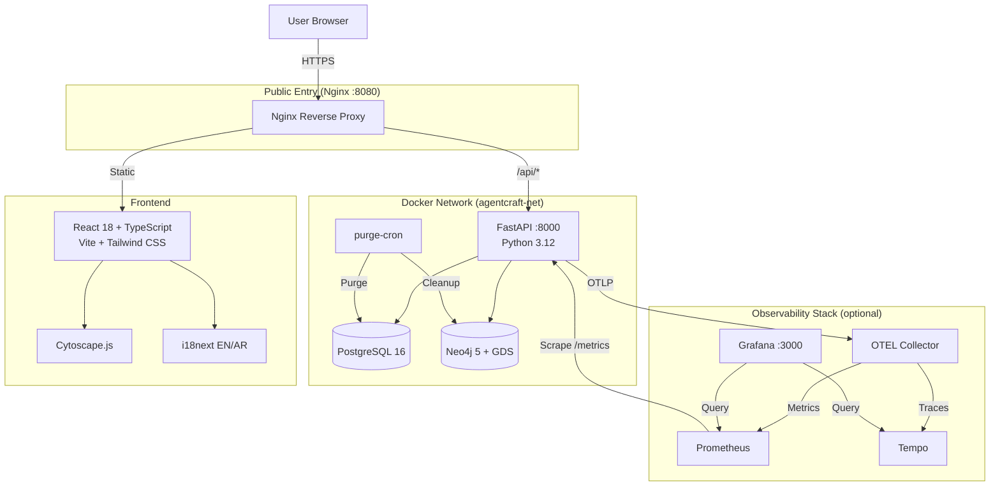

# 🧪 AgentCraft Engineering Lab

> An open-source, hands-on learning laboratory for software engineers exploring
> **graph intelligence** and **observability** through ten canonical, deterministic
> experiments — with real traces, real metrics, and a grounded AI mentor.

[](https://github.com/mayakilzy/AgentCraft-Engineering-Lab/actions)
[](https://www.python.org/)
[](https://fastapi.tiangolo.com/)
[](https://react.dev/)
[](https://www.typescriptlang.org/)
[](https://www.postgresql.org/)
[](https://neo4j.com/)
[](https://docs.docker.com/compose/)

**[English](README.md)** | **[العربية](ar.readme)**

---

## Table of Contents

1. [Project Overview](#1-project-overview)
2. [Vision & Philosophy](#2-vision--philosophy)
3. [Core Features](#3-core-features)
4. [Experiments E01–E10](#4-experiments-e01e10)
5. [User Journey](#5-user-journey)
6. [Technical Architecture](#6-technical-architecture)
7. [Installation & Deployment](#7-installation--deployment)
8. [Testing & Quality](#8-testing--quality)
9. [Security & Privacy](#9-security--privacy)
10. [Architecture Reusability & Application Factory](#10-architecture-reusability--application-factory)
11. [Roadmap & Future Extensions](#11-roadmap--future-extensions)
12. [Known Limitations](#12-known-limitations)

---

## 1. Project Overview

AgentCraft Engineering Lab is an interactive learning platform where software
engineers **learn by doing** — not by reading slides. Instead of passive tutorials,
users run real experiments against real graph databases, real telemetry pipelines,
and real observability dashboards. Every result is deterministic and verifiable;
nothing is mocked or faked.

### The Problem

Engineering teams need practical understanding of graph intelligence (dependency
analysis, community detection, shortest-path reasoning) and observability (distributed
tracing, metrics, failure diagnosis). Existing learning resources are either
theoretical (articles, videos) or too complex to set up (production-grade
infrastructure). AgentCraft bridges this gap with a self-contained lab that runs
on a single machine.

### Target Audience

- **Software engineers** exploring graph databases and observability for the first time.
- **DevOps practitioners** learning distributed tracing and metrics dashboards.
- **Engineering teams** onboarding new members to graph + observability concepts.
- **Educators** teaching software architecture and operations.

---

## 2. Vision & Philosophy

> **"Don't tell me — show me. Don't show me — let me do it."**

AgentCraft is built on three principles:

| Principle | What it means |
|---|---|
| **Learn by doing** | Every concept is taught through a hands-on experiment, not a lecture. |
| **Honest evidence** | No mock success. If a service is unavailable, the lab says BLOCKED — not PASSED. |
| **Deterministic results** | Fixtures are versioned and reproducible. Reruns produce identical outputs. |

The lab does **not** attempt to replace production-grade tools or comprehensive
courses. It provides a focused, practical on-ramp to ten core concepts that
every modern software engineer should understand.

---

## 3. Core Features

### Interactive Engineering Experiments

**What it does:** Ten pre-built, deterministic experiments covering graph
modeling, shortest path, centrality, community detection, SQL/Cypher parity,
distributed tracing, metrics dashboards, and failure diagnosis.

**Why it matters:** Engineers learn best when they can run, observe, and verify
results — not when they read abstract descriptions.

**How users benefit:** Each experiment has a clear objective, step-by-step
instructions, and a validator that confirms whether the expected outcome was
achieved.

### Guided Mode

**What it does:** Walks the user through each step of an experiment with
localized instructions (English + Arabic), expected results, and a validator
at each stage.

**Why it matters:** Beginners need scaffolding. Guided mode provides it without
removing the hands-on nature of the experiment.

**How users benefit:** Users follow a structured path, see their progress, and
get immediate feedback on each step.

### Challenge Mode

**What it does:** Presents the objective and inputs without revealing the
solution. The user must figure out the correct approach and verify their
result against the validator.

**Why it matters:** Learning sticks when users must think for themselves.

**How users benefit:** Users test their understanding without spoilers, then
compare their approach to the expected outcome.

### Deterministic AI Mentor

**What it does:** A grounded, read-only mentor that answers questions about
run results using only the evidence from the run record. It classifies its
confidence as `confirmed`, `likely`, or `insufficient_evidence` — never
claiming certainty it doesn't have.

**Why it matters:** AI tutors that hallucinate are dangerous in engineering
education. The mentor is deterministic by default — it matches keywords
against run evidence and never makes unsupported causal claims.

**How users benefit:** Users get contextual explanations of why a run passed
or failed, what the trace_id means, and what to check next — grounded in
actual data.

### Interactive Graph Visualization

**What it does:** Cytoscape.js-powered viewer with four layout algorithms,
kind-based filtering, node/edge selection panels, and keyboard-accessible
controls.

**Why it matters:** Graph concepts are abstract until you see them rendered.
Interactive exploration makes the topology tangible.

**How users benefit:** Users can switch layouts, filter by node kind, inspect
edge details, and verify that the seeded graph matches the expected topology.

### Experiment Execution & Results

**What it does:** Each run is persisted with its step verdicts, trace_id,
inputs (redacted), outputs, and timing. Results are comparable across runs
and exportable as Markdown or JSON.

**Why it matters:** Learning is iterative. Users need to compare runs,
export reports, and revisit history.

**How users benefit:** Run history is session-scoped and persistent. Users
can reset, rerun, compare two runs side-by-side, and export reports with
provenance.

### Arabic/English Localization & RTL

**What it does:** Full bilingual support with i18next. Technical labels
(operation keys, validator keys, dataset keys) stay untranslated per
A12. Arabic mode flips the document to RTL.

**Why it matters:** The lab serves a global audience, including Arabic-
speaking engineers who need technical content in their native language.

**How users benefit:** Users switch language from the navbar; the choice
persists per session. Arabic mode renders with proper RTL direction.

### Guest Sessions & Isolation

**What it does:** Each visitor gets an opaque, HttpOnly, SameSite=Lax cookie
that scopes all their data. Cross-session access returns 404 (not 403 — to
avoid leaking run existence).

**Why it matters:** A public learning lab must not allow users to see each
other's experiments, runs, or graph data.

**How users benefit:** Users can experiment freely knowing their data is
isolated. Sessions expire after 24h and are purged by a scheduled cron.

### Observability & Diagnostics

**What it does:** OpenTelemetry instrumentation captures traces (fetch →
transform → persist) with run_id correlation. Prometheus scrapes metrics.
Grafana visualizes dashboards. The lab teaches users to use these tools.

**Why it matters:** Observability is a core engineering skill. The lab
teaches it by having users interact with real traces and metrics.

**How users benefit:** Users see their run's trace_id, open Grafana deep-
links, inspect spans, and diagnose failures — all through the lab UI.

### Docker-based Deployment

**What it does:** A single `docker compose` command brings up the entire
stack — PostgreSQL, Neo4j, FastAPI, Nginx, OTEL Collector, Prometheus,
Tempo, Grafana, and a scheduled purge-cron.

**Why it matters:** The lab must be reproducible and deployable without
manual infrastructure setup.

**How users benefit:** Clone, configure `.env`, run one command, open
`http://localhost:8080`.

---

## 4. Experiments E01–E10

| # | Experiment | Level | Time | Concepts | Technologies |
|---|---|---|---|---|---|
| E01 | [Build Your First Graph](#e01) | Beginner | 20 min | Graph modeling, directed edges, endpoint integrity | NetworkX, PostgreSQL, Cytoscape.js |
| E02 | [Shortest Path](#e02) | Beginner | 20 min | Directed shortest path, unreachable handling | NetworkX |
| E03 | [Interactive Graph Explorer](#e03) | Beginner | 25 min | Layout switching, kind filtering, data integrity | Cytoscape.js |
| E04 | [SQL versus Cypher](#e04) | Intermediate | 25 min | Query parity, canonical set comparison, timing context | PostgreSQL, Neo4j |
| E05 | [Critical Dependencies](#e05) | Intermediate | 25 min | Directed reachability, centrality vs criticality | NetworkX |
| E06 | [Discover Communities](#e06) | Intermediate | 25 min | Community detection, GDS licensing, provenance | Neo4j GDS, NetworkX |
| E07 | [Trace One Request](#e07) | Intermediate | 25 min | Distributed tracing, span correlation, trace_id | OpenTelemetry, Tempo |
| E08 | [Build Monitoring Dashboard](#e08) | Intermediate | 25 min | Request rate, error rate, latency, P50/P95 | Prometheus, Grafana |
| E09 | [Diagnose a Hidden Failure](#e09) | Advanced | 30 min | Failure injection, trace-based diagnosis, recovery | OpenTelemetry, Grafana |
| E10 | [Graph and Observability Challenge](#e10) | Advanced | 40 min | Integrated graph + telemetry, critical edge identification | NetworkX, OpenTelemetry, Grafana |

### E01 — Build Your First Graph

**Concept:** Graph modeling with directed edges and endpoint integrity.

**Goal:** Seed five tool nodes, create four directed edges, and verify that every
edge has both endpoints in the node set.

**How to interact:** Load the `starter-five-v1` fixture, inspect the seeded nodes,
add the prescribed edges, run the validator, and inspect the Cytoscape visualization.

**What users learn:** Why edge direction matters (consumer → provider), what
dangling edges are, and how a validator catches integrity violations that
count-only checks miss.

### E02 — Shortest Path

**Concept:** Directed shortest path computation and unreachable handling.

**Goal:** Find the shortest directed path from application A to tool T3, then
verify that an unreachable pair (A → ISO) returns null.

**What users learn:** How `nx.shortest_path` works on directed graphs, why
unreachable nodes return `None` (not an error), and how validators handle
honest negative results.

### E03 — Interactive Graph Explorer

**Concept:** Interactive graph exploration with layout switching and kind filtering.

**Goal:** Load a mixed-kind graph (apps, tools, skills), switch between four layout
algorithms, filter by node kind, and verify that the original data is unaffected.

**What users learn:** How layout algorithms affect visual perception, how
filtering creates subgraphs without mutating the source, and how to inspect
node/edge details in Cytoscape.js.

### E04 — SQL versus Cypher

**Concept:** Relational vs graph query parity.

**Goal:** Run the same dependency query on PostgreSQL and Neo4j, compare canonical
result sets (order-independent), and inspect timing context (cold/warm/iterations).

**What users learn:** When graph databases outperform relational ones for
traversal queries, how to compare canonical sets (not ordering), and why timing
context matters. When Neo4j is unavailable, the experiment is honestly BLOCKED.

### E05 — Critical Dependencies

**Concept:** Directed reachability impact vs naive degree centrality.

**Goal:** Identify which node, when removed, makes other nodes unreachable — and
compare that with the node's degree centrality score.

**What users learn:** "Most central" ≠ "most critical." Reachability impact
measures operational criticality; degree centrality measures connectivity. They
are different signals that should not be conflated.

### E06 — Discover Communities

**Concept:** Community detection with honest GDS provenance.

**Goal:** Apply community detection to a synthetic clustered graph. If GDS is
available and licensed, run Louvain. If not, run the NetworkX fallback —
clearly labelled as `networkx_fallback`, never as GDS.

**What users learn:** How community detection groups densely connected nodes,
why GDS licensing matters, and why provenance labelling prevents misleading
claims.

### E07 — Trace One Request

**Concept:** Distributed tracing across fetch → transform → persist spans.

**Goal:** Run a synthetic operation, capture the run's `trace_id`, inspect the
trace spans, identify the slowest span, and report.

**What users learn:** How OpenTelemetry spans correlate with run records, how
trace_id links to Grafana Tempo, and why ≥3 spans prove the trace pipeline works.

### E08 — Build Monitoring Dashboard

**Concept:** Observing request rate, error rate, and latency over a controlled
workload.

**Goal:** Run a bounded set of lab operations, open the metrics summary, inspect
Prometheus/Grafana, and interpret the results with explicit units and time windows.

**What users learn:** What P50/P95 mean (computed from histogram buckets via
linear interpolation), how to read Prometheus metrics, and why the metrics
summary never reports fake nonzero values.

### E09 — Diagnose a Hidden Failure

**Concept:** Failure injection, trace-based diagnosis, and recovery demonstration.

**Goal:** Inject a bounded failure at the `transform` step, use the trace to
locate the failing span, ask the mentor for context, then run a **recovery
demonstration** (a different operation without the injection) to verify the
workflow succeeds when the fault is removed.

**What users learn:** How to use traces for root-cause analysis, how failure
injection is bounded (sleep_ms ≤ 1500, fail_step ∈ {fetch, transform, persist}),
and why a recovery demonstration is different from a re-execution of the failed
operation.

### E10 — Graph and Observability Challenge

**Concept:** Integrated graph analysis + telemetry diagnostics.

**Goal:** Load an integrated dependency graph, identify the critical edge via
shortest path, inject a failure, trace it, and run a recovery demonstration —
combining graph intelligence and observability in one experiment.

**What users learn:** How graph topology and telemetry complement each other
for root-cause analysis, and how to export a complete diagnostic report (md/json)
for the entire diagnosis trail.

---

## 5. User Journey



---

## 6. Technical Architecture



### Technology Stack

| Layer | Technology | Role |
|---|---|---|
| Frontend | React 18 + TypeScript 5.6 + Vite 6 | SPA with routing, i18n, forms |
| Visualization | Cytoscape.js 3.34 | Interactive graph rendering |
| Styling | Tailwind CSS 3.4 | Utility-first responsive design |
| i18n | i18next 23 + react-i18next 15 | EN/AR bilingual with RTL |
| Backend | FastAPI 0.128 + Python 3.12 | REST API, Pydantic validation |
| ORM | SQLAlchemy 2.0 + Alembic 1.14 | Models, migrations, dialect-agnostic |
| Database | PostgreSQL 16 (prod) / SQLite (dev) | Guest sessions, runs, graph data |
| Graph DB | Neo4j 5 Community + GDS plugin | Cypher parity, community detection |
| Graph Algorithms | NetworkX 3.4 | Shortest path, centrality, reachability |
| Telemetry | OpenTelemetry SDK + OTLP exporter | Span instrumentation, trace_id correlation |
| Metrics | Prometheus 2.55 | Request rate, error rate, latency P50/P95 |
| Traces | Tempo 2.6 | Distributed trace storage + search |
| Dashboards | Grafana 11.3 | Pre-provisioned datasources + dashboard |
| Proxy | Nginx | Public entry point, /metrics block, SPA fallback |
| Containerization | Docker Compose | Multi-profile stack (core/observability/neo4j/test) |

### Key Design Decisions

| Decision | Rationale |
|---|---|
| SQLite for dev, PostgreSQL for prod | Fast test loop; same ORM + migrations |
| FakeDriver for Neo4j tests | Tests run without a Neo4j instance; real runtime verified in CI |
| In-process OTEL (no Collector in dev) | Spans are created and testable; Collector added in Compose |
| Manifest YAML files (not code) | Trusted, versioned, validated on boot; no dynamic Python import |
| Fail-closed production validator | App aborts boot if passwords are default/empty or CORS is localhost |
| purge_tasks table for recoverable cleanup | Neo4j cleanup failures don't lose session_ids; retry on next run |

---

## 7. Installation & Deployment

### Local Development

```bash
# Clone
git clone https://github.com/mayakilzy/AgentCraft-Engineering-Lab.git
cd AgentCraft-Engineering-Lab

# Backend (Terminal 1)
cd backend
pip install -e ".[dev]"  # or install deps manually
DATABASE_URL="sqlite:///./agentcraft.db" APP_ENV=local \
  python3 -m uvicorn app.main:app --reload --port 8000

# Frontend (Terminal 2)
cd frontend
npm install
npm run dev
```

Open `http://localhost:5173/` in your browser.

### Docker Compose (Ubuntu Server)

**Target:** Ubuntu Server, 6 vCPU, 12 GB RAM, Docker + Docker Compose.

```bash
# 1. Clone
git clone https://github.com/mayakilzy/AgentCraft-Engineering-Lab.git
cd AgentCraft-Engineering-Lab

# 2. Configure environment
cp .env.example .env
# Edit .env — set strong passwords, APP_ENV, CORS_ORIGINS:
#   APP_ENV=production
#   POSTGRES_PASSWORD=<strong-non-default>
#   NEO4J_PASSWORD=<strong-non-default>
#   GRAFANA_ADMIN_PASSWORD=<strong-non-default>
#   SESSION_COOKIE_SECURE=true
#   CORS_ORIGINS=["https://your-domain"]

# 3. Start the core stack (PostgreSQL + API + Nginx + purge-cron)
docker compose --profile core up -d --build

# 4. (Optional) Add Neo4j for E04/E06
docker compose --profile neo4j up -d --build

# 5. (Optional) Add full observability stack
docker compose --profile observability up -d --build

# 6. Access
#   Frontend:  http://localhost:8080
#   Grafana:   http://localhost:3000
#   API:       internal only (proxied via Nginx)
```

### Nginx Proxy Manager Integration

For public HTTPS access via Nginx Proxy Manager (NPM):

1. Ensure NPM and the Compose stack share a Docker network (or use the host IP).
2. Create a Proxy Host pointing to the `web` container on port 80:
   - **Forward Hostname:** `agentcraft-web-1` (or the container IP)
   - **Forward Port:** `80`
3. Enable SSL with Let's Encrypt.
4. Set `CORS_ORIGINS` in `.env` to your HTTPS domain.
5. Set `SESSION_COOKIE_SECURE=true` (the Secure flag requires HTTPS).

> **Important:** NPM must be able to reach the `web` container. If NPM runs in
> a separate Compose project, attach it to the same network or use the host IP.

### Compose Profiles

| Profile | Services | Purpose |
|---|---|---|
| `core` | PostgreSQL, API, Nginx, purge-cron | Minimum viable lab |
| `neo4j` | Neo4j + GDS plugin | E04 (SQL/Cypher) + E06 (communities) |
| `observability` | OTEL Collector, Prometheus, Tempo, Grafana | E07–E10 (telemetry) |
| `test` | test-runner | CI integration smoke tests |

### Resource Limits

Each service has a memory limit in `docker-compose.yml`:

| Service | Memory Limit |
|---|---|
| PostgreSQL | 512 MB |
| API | 512 MB |
| Nginx | 128 MB |
| Neo4j | 1 GB |
| OTEL Collector | 256 MB |
| Prometheus | 256 MB |
| Tempo | 512 MB |
| Grafana | 256 MB |
| purge-cron | 128 MB |
| test-runner | 256 MB |

Total: ~3.8 GB — well within 12 GB RAM.

---

## 8. Testing & Quality

### Test Suite

| Suite | Tests | Status |
|---|---|---|
| Backend (pytest) | 363 | ✅ PASS |
| Frontend (Vitest) | 17 | ✅ PASS |
| **Total** | **380** | **✅ PASS** |

### CI Pipeline

The GitHub Actions workflow (`.github/workflows/docker-smoke.yml`) runs the
full Docker Compose stack and integration tests:

- ✅ PostgreSQL connectivity + migrations + table verification
- ✅ Neo4j connectivity + GDS probe + namespace isolation
- ✅ Prometheus scraping + metrics verification
- ✅ Tempo readiness + trace flow
- ✅ Grafana health + datasource provisioning
- ✅ OTEL Collector health
- ✅ Nginx /metrics block (403 externally, accessible internally)
- ✅ Session persistence across API restart
- ✅ Cookie flags (HttpOnly + SameSite + Secure in production mode)
- ✅ purge-cron execution

**Last successful CI run:**
- **Run #13** — Commit `fa2997d`
- **Result:** SUCCESS
- **URL:** https://github.com/mayakilzy/AgentCraft-Engineering-Lab/actions/runs/38226312969

### What is tested vs. what requires runtime verification

| Category | Tested | Method |
|---|---|---|
| Backend API (in-process) | ✅ | 363 pytest tests against SQLite |
| Frontend UI (component) | ✅ | 17 Vitest tests |
| PostgreSQL runtime | ✅ | CI integration smoke |
| Neo4j runtime | ✅ | CI integration smoke |
| GDS licensing | ✅ | CI probe (exact procedure match) |
| OTEL trace flow | ✅ | CI creates run + queries Tempo |
| Prometheus metrics | ✅ | CI queries Prometheus API |
| Grafana provisioning | ✅ | CI checks datasources API |
| Session isolation | ✅ | Cross-session 404 tests |
| Fail-closed production | ✅ | 13 negative config tests |
| Rate limiting | ✅ | Token-bucket 429 tests |
| Purge recoverability | ✅ | purge_tasks retry tests |
| Browser visual acceptance | ❌ | Not yet performed (see Known Limitations) |

---

## 9. Security & Privacy

### Session Isolation

- Each visitor gets an opaque, 256-bit random cookie (`secrets.token_urlsafe(32)`).
- The cookie is `HttpOnly`, `SameSite=Lax`, and `Secure` (when `SESSION_COOKIE_SECURE=true`).
- All API endpoints resolve the session server-side from the cookie — no client-
  provided `session_id` is ever trusted.
- Cross-session access returns 404 (not 403) to avoid leaking run existence.

### Data Isolation

- Graph nodes/edges are scoped by `(session_id, dataset_id)` at the database level.
- Neo4j data uses session-scoped namespace labels (`__sess_<hex>__ds_<id>__`).
- Run records are scoped by `session_id` with a database index.
- The mentor only accesses the current session's run evidence — never other
  sessions' data.

### Secret Management

- `.env` is gitignored; `.env.example` carries only `changeme` placeholders.
- Production mode (`APP_ENV=production`) aborts boot if any password is default
  or empty, if `SESSION_COOKIE_SECURE` is false, or if CORS contains localhost.
- CI generates ephemeral secrets at runtime (`openssl rand -hex 16`).
- No secrets are ever logged or included in API responses.

### Network Security

- FastAPI is NOT exposed publicly — only Nginx (port 8080) is the public entry.
- Prometheus, Tempo, OTEL Collector, PostgreSQL, Neo4j have no public ports.
- `/metrics` is blocked externally via Nginx (`deny all; return 403`).
- Rate limiting (60/min per session) is enforced on `POST /experiments/{id}/runs`.

### Safe Experimentation

- All operations are allowlisted Python handlers — no dynamic code execution.
- Manifests are trusted YAML files validated on boot; no user-supplied manifests.
- Failure injection is bounded: `sleep_ms ≤ 1500`, `fail_step ∈ {fetch, transform, persist}`.
- Input redaction: any key matching `token`, `password`, `secret`, `cookie`, `api_key`
  is stored as `[REDACTED]` in run records.

---

## 10. Architecture Reusability & Application Factory

### A. Reusable Architectural Foundation

AgentCraft's architecture separates **platform core** from **domain modules**.
The platform core is reusable; the domain modules (graph + observability
experiments) are specific to the current educational focus.

| Component | Reusable? | What it provides |
|---|---|---|
| Experiment/Module Registry | ✅ General | YAML manifest schema + Pydantic validation + operation/validator cross-check |
| Execution Engine | ✅ General | Run state machine (CREATED→RUNNING→PASSED/FAILED/BLOCKED), per-step inputs, validator-driven status |
| Guided/Challenge Interaction | ✅ General | Mode switch, step-by-step instructions, expected/actual comparison |
| Mentor Interface | ✅ General | Grounded Q&A with `diagnosis_state` + `evidence_refs` + `provider_mode` |
| Graph Visualization | ✅ General | Cytoscape.js viewer with 4 layouts, kind filter, selection panels |
| Session Management | ✅ General | Guest cookies, TTL, purge-cron, cross-session isolation |
| Result Evaluation | ✅ General | Validator registry, pass/fail verdicts, export md/json, run comparison |
| Localization | ✅ General | i18next EN/AR, RTL, technical labels untranslated |
| Observability | ✅ General | OTEL instrumentation, Prometheus metrics, Grafana dashboards |
| Deployment Infrastructure | ✅ General | Docker Compose profiles, Nginx proxy, health checks, resource limits |
| Graph Experiments (E01–E06, E10) | 🔵 Domain-specific | NetworkX algorithms, Neo4j parity, graph fixtures |
| Observability Experiments (E07–E09) | 🔵 Domain-specific | Trace demo, metrics demo, failure injection |

### B. Extensibility Model

Adding a new learning module requires:

1. **Create a manifest YAML** in `lab-modules/` — the loader validates it on boot.
2. **Implement an operation handler** — a Python function registered with
   `@register_operation("your_key")` that returns an `OperationResult`.
3. **Implement a validator** — a Python function registered with
   `@register_validator("your_key")` that returns a `ValidationResult`.
4. **Add fixtures** — deterministic data (graphs, configs, expected results).
5. **No frontend changes needed** — the gallery auto-discovers manifests.

The manifest schema (`app/lab/manifest_schema.py`) enforces:
- Unique IDs (no duplicates across manifests).
- Known operation_key + validator_key (cross-checked at boot, fail-closed).
- Bilingual content (en + ar for title, description, step instructions).
- Per-step inputs (merged over run-level inputs, step-level wins).
- Forbidden keys in step.inputs (`session_id`, `cookie_token`).

### C. Cross-Domain Applications

The platform core can be adapted for other educational domains:

| # | Domain | Target Users | Reuse | Build New | Example Journey |
|---|---|---|---|---|---|
| 1 | Cybersecurity Training | Security analysts | Session mgmt, mentor, execution engine, observability | Attack/defense scenarios, vulnerability simulators | Load a network topology → inject an attack → trace the breach → diagnose the vector |
| 2 | AI Agents & Multi-Agent Systems | AI engineers | Graph visualization, execution engine, mentor | Agent communication protocols, emergent behavior simulators | Define agents → run interactions → visualize communication graph → diagnose deadlocks |
| 3 | Data Engineering Lab | Data engineers | Execution engine, result evaluation, observability | ETL pipelines, schema evolution, data quality checks | Build a pipeline → inject a schema change → trace the failure → fix and rerun |
| 4 | Cloud & DevOps Training | DevOps engineers | Observability, session mgmt, deployment infra | Kubernetes manifests, CI/CD pipelines, infra-as-code | Deploy a service → inject a config error → trace the rollout failure → rollback |
| 5 | Network Engineering Simulator | Network engineers | Graph visualization, execution engine | Topology design, routing protocols, packet flow simulators | Design a network → simulate a link failure → trace the reroute → compare paths |
| 6 | Database & Query Optimization | DBAs | Graph visualization, result evaluation | Query plans, index strategies, join optimization | Run a slow query → inspect the plan → add an index → compare performance |
| 7 | Software Architecture Learning | Architects | Graph visualization, execution engine | Dependency graphs, module boundaries, coupling analysis | Model a system → detect circular deps → refactor → verify decoupling |
| 8 | Robotics & Automation Education | Robotics engineers | Execution engine, observability | Sensor data pipelines, actuator control, safety interlocks | Program a sequence → inject a sensor failure → trace the safety response |
| 9 | Business Process Simulation | Operations teams | Execution engine, result evaluation | BPMN workflows, approval chains, bottleneck analysis | Model a process → inject a delay → measure throughput → optimize |
| 10 | Scientific Experimentation | Researchers | Execution engine, result evaluation, export | Domain-specific simulations, data analysis pipelines | Configure parameters → run simulation → export results → compare variants |
| 11 | Healthcare Professional Training | Medical professionals | Session mgmt, mentor, execution engine | Clinical scenarios, diagnostic workflows, patient safety | Present symptoms → run diagnostic tests → trace the reasoning → validate diagnosis |
| 12 | Enterprise Technical Onboarding | New hires | Session mgmt, localization, observability | Company-specific architecture tours, tool walkthroughs | Explore the system → run guided tutorials → ask the mentor → export a completion report |

**Level of reuse:** The platform core (registry, execution engine, mentor,
session management, localization, observability, deployment) is directly
reusable. The domain-specific content (experiments, fixtures, operations,
validators) must be built for each domain. The graph visualization component
is reusable for any domain that models relationships as graphs.

### D. Reference Architecture

```mermaid
graph TB
    subgraph "Reusable Platform Core"
        REG[Experiment Registry<br/>YAML manifests + schema validation]
        ENG[Execution Engine<br/>Run state machine + per-step inputs]
        MEN[Mentor Interface<br/>Grounded Q&A + diagnosis_state]
        SES[Session Management<br/>Guest cookies + TTL + purge]
        EVAL[Result Evaluation<br/>Validators + export + compare]
        I18N[Localization<br/>i18next EN/AR + RTL]
        OBS[Observability<br/>OTEL + Prometheus + Tempo + Grafana]
        DEP[Deployment<br/>Docker Compose + Nginx + profiles]
    end

    subgraph "Domain Module: Graph Intelligence"
        E01_E06[Experiments E01-E06<br/>Graph modeling, paths, communities]
        NX[NetworkX adapter]
        N4J[Neo4j + GDS service]
        CYTO[Cytoscape.js viewer]
        FX1[Graph fixtures<br/>starter-five-v1, communities-v1, etc.]
    end

    subgraph "Domain Module: Observability"
        E07_E09[Experiments E07-E09<br/>Tracing, metrics, failure diagnosis]
        OTEL_OPS[Trace demo operations]
        FX2[Trace/metrics fixtures]
    end

    subgraph "Future Domain: Cybersecurity Lab"
        CYB[Attack/defense scenarios]
        NET[Network topology simulator]
    end

    REG --> E01_E06
    REG --> E07_E09
    REG --> CYB
    ENG --> NX
    ENG --> OTEL_OPS
    ENG --> NET
    MEN --> E01_E06
    MEN --> E07_E09
    EVAL --> E01_E06
    EVAL --> E07_E09
```



### E. Architectural Boundaries

**Currently reusable (implemented and tested):**
- Experiment registry with YAML schema validation
- Execution engine with per-step inputs and validator-driven status
- Mentor service with deterministic fallback
- Session management with purge_tasks recovery
- Rate limiting + fail-closed production validator
- Docker Compose profiles + CI integration smoke
- i18next EN/AR localization with RTL

**Directional future (not yet extracted):**
- The platform core is currently coupled to the lab-modules directory structure.
  A future extraction would separate it into an installable package.
- The operation/validator registries use module-level decorators. A plugin
  system (entry points) would make third-party modules easier to add.
- The frontend gallery is specific to the experiment card layout. A generic
  "module gallery" component would support other content types.

**AgentCraft is not currently a general-purpose application factory.** It is
a well-structured learning lab whose architecture *can be extracted and
reused* for other domains with moderate effort. The claims above describe
what exists, not what is promised.

---

## 11. Roadmap & Future Extensions

### Planned (not yet implemented)

| Feature | Description | Priority |
|---|---|---|
| LLM-powered mentor | Optional OpenAI integration with deterministic fallback | Future |
| Playwright E2E tests | Browser acceptance tests in CI | Future |
| Additional languages | French, Spanish, Turkish localization | Future |
| Platform core extraction | Separate reusable core as an installable package | Future |
| Plugin system | Entry-point-based operation/validator registration | Future |
| Progressive Web App | Offline-capable frontend with service workers | Future |

### Not in scope (V1.0 frozen)

- Multi-tenant admin panel
- Real-time collaborative experiments
- External API for third-party integrations
- Mobile-native apps
- User accounts / authentication (guest sessions only in V1)

---

## 12. Known Limitations

| Limitation | Status | Impact |
|---|---|---|
| Docker runtime not available in dev env | BLOCKED | CI verifies runtime; local dev uses SQLite + in-process OTEL |
| Browser visual acceptance not performed | Pending | UI tested via component tests; visual preview requires deployment |
| Tempo trace indexing latency | Soft skip | CI accepts 404 as "not yet indexed" — not a hard failure |
| GDS not licensed in CI | NOT_AVAILABLE | E06 uses NetworkX fallback; honestly labelled |
| 4 Dependabot moderate alerts | Triaged | Documented in ADR-0002; not exploitable in our usage pattern |

---

## License

This project is open-source. See the repository for license details.

## Contributors

- **GLM** — Primary developer (G01–G08)
- **ChatGPT** — Engineering supervisor and reviewer
- **Ayman** — Project owner and vision lead

## Repository

- **GitHub:** https://github.com/mayakilzy/AgentCraft-Engineering-Lab
- **CI:** https://github.com/mayakilzy/AgentCraft-Engineering-Lab/actions
- **Reports:** `reports/` directory in the repository
